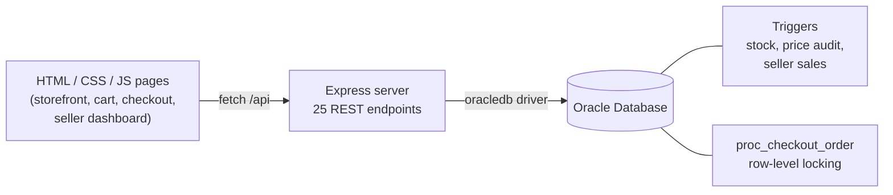

<h1>E-Commerce Marketplace Management System</h1>

<p>
  
  
  
  
  
  
</p>

A web marketplace that connects sellers and customers: sellers list and manage stock, customers browse,
add to cart, check out and review, and every order is kept consistent by the database itself. Built for
the Software Engineering course at FAST-NUCES Karachi, with a full requirements and design document set.

<p align="center">
  
</p>

## Highlights

- **Three roles:** customer, seller and admin, each with their own pages and login
- **Checkout that cannot oversell:** a PL/SQL procedure locks the product rows (`SELECT ... FOR UPDATE`)
  before reducing stock, so two shoppers buying the last item cannot both succeed
- **Rules in the database, not only in the app:** triggers block negative stock, audit every price
  change and keep each seller's sales totals up to date
- **Clean relational model:** 10 normalised tables with sequences and auto-ID triggers
- **25 REST endpoints** across products, categories, cart, orders, payments, addresses, reviews,
  customers and sellers
- **Documented like a real project:** PRD, app flow, tech stack, frontend guidelines, backend schema
  and implementation plan in [`docs/proposal`](docs/proposal)

## Architecture



## Data model

| Table | Holds |
|---|---|
| `Customer`, `Address` | shoppers and their delivery addresses |
| `Seller` | seller accounts and running sales totals |
| `Category`, `Product` | catalogue, price and stock |
| `Cart` | items a customer is about to buy |
| `Orders`, `OrderItem` | placed orders and their lines |
| `Payment` | payment record per order |
| `Review` | customer ratings and comments |

Database objects beyond the tables (in [`Database/advanced.sql`](Database/advanced.sql)):

| Object | What it does |
|---|---|
| `proc_checkout_order` | turns a cart into an order inside one transaction, locking stock rows first |
| `trg_prevent_negative_stock` | rejects any update that would take stock below zero |
| `trg_audit_price_change` | records every price change with old and new values |
| `trg_update_seller_sales` | keeps each seller's sales total in step with new orders |

## Run it locally

**You need:** Node.js (LTS), an Oracle Database (XE is fine) and the 64-bit Oracle Instant Client on your `PATH`.

```bash
npm install
```

Create a `.env` in the project root:

```ini
DB_USER=your_db_user
DB_PASSWORD=your_db_password
DB_CONNECT_STRING=localhost/XE
ORACLE_CLIENT_LIB_DIR=C:\oracle\instantclient_19_8
PORT=3000
```

Create the database objects, in this order, from SQL*Plus or SQL Developer:

1. `Database/schema.sql` (tables, sequences, ID triggers)
2. `Database/seed.sql` (sample data)
3. `Database/advanced.sql` (business triggers and the checkout procedure)
4. `Database/apply_constraints.sql` (price constraints)

Then start the server and open http://localhost:3000:

```bash
npm start
```

<details>
<summary><b>Troubleshooting</b></summary>

- **`DPI-1047: Cannot locate a 64-bit Oracle Client library`:** check `ORACLE_CLIENT_LIB_DIR`, use the
  64-bit Instant Client with 64-bit Node, and restart the terminal after changing `PATH`.
- **`ORA-12541: TNS:no listener`:** the Oracle service is not running; start it from Windows Services.
- **`ORA-01017: invalid username/password`:** check `DB_USER` and `DB_PASSWORD` in `.env`.

</details>

## Project structure

```
Backend/scripts/     helper scripts to apply schema changes and check data
Database/            schema, seed data, triggers, procedure, constraints
Frontend/Public/     storefront, cart, checkout, orders, seller pages
Frontend/Routes/     Express routers, one per resource
docs/proposal/       PRD, app flow, tech stack, guidelines, schema, plan
server.js            app entry point
```

## Team

[Fatima Salahuddin](https://github.com/fatima-salahuddin) · [Rimsha Amjad](https://github.com/rimsha-amjad)
<br><sub>Software Engineering, FAST-NUCES Karachi</sub>
